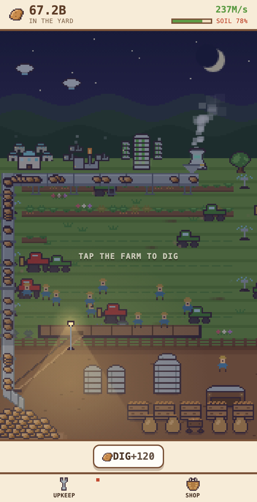
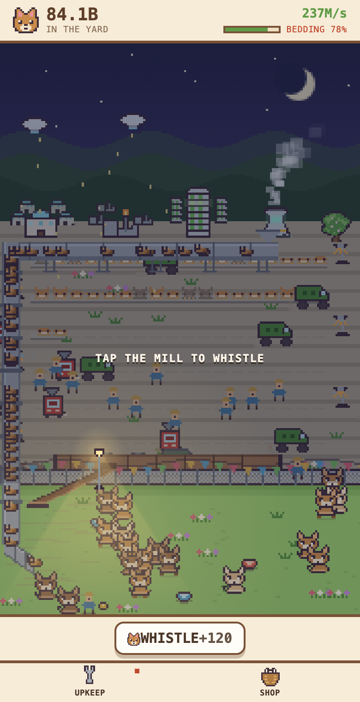
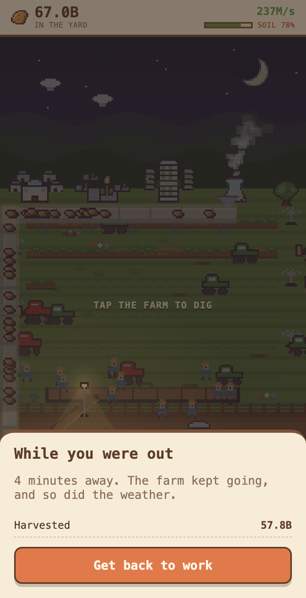

# Clickers

Two clicker games, one engine: a potato farm and a puppy mill sharing the same
simulation under different themes.

- **Yield, Inc.** — grow potatoes. Play: [battle-clicker-web.vercel.app](https://battle-clicker-web.vercel.app)
- **Puppy Mill** — breed chihuahuas. Play: [puppy-mill-web.vercel.app](https://puppy-mill-web.vercel.app)

| Yield, Inc. | Puppy Mill | While you were out |
|---|---|---|
|  |  |  |

## The idea

A clicker gets a second axis once something is actively taking your production
away: every purchase becomes "grow" vs. "hold onto what I've got." Here that
pressure is **weather** — storms land while the tab is closed, damage is
permanent until repaired, and defense is buildings you buy, not shields you
time. The front door of each game is a persistent solo homestead with a
prestige loop; head-to-head versus mode (bots, or a real person by join code)
is parked in the back room, fully working.

## How it's built

There is **no tick loop**. Game state is a pure function of
`(checkpoint, elapsed, rate, active effects)` — client and server both
integrate forward to "now" on demand, which is what makes offline progression
free and a request/response backend viable. Multiplayer is an append-only
command log in Postgres; no game state ever lives in a database column, so
two sabotages landing at once can't corrupt anything. (Details in
`docs/STACK.md` and `docs/multiplayer.md`.)

- `packages/sim` — the whole simulation as pure TypeScript, zero I/O, shared
  by both games and both sides of the wire. This is where the tests live.
- `packages/online` — the Supabase command-log client.
- `apps/potatoes`, `apps/puppies` — React + Vite skins over the same sim.

## Run it

```bash
npm install
npm run dev:potatoes   # or dev:puppies
npm test               # vitest against packages/sim
npm run typecheck
```
