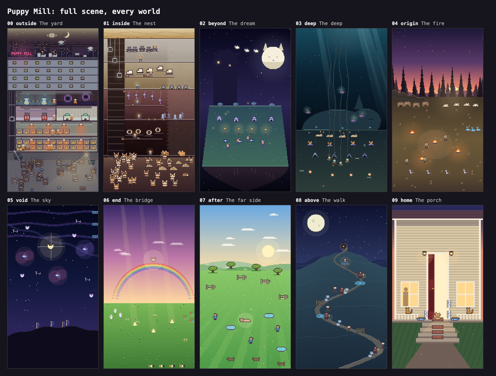
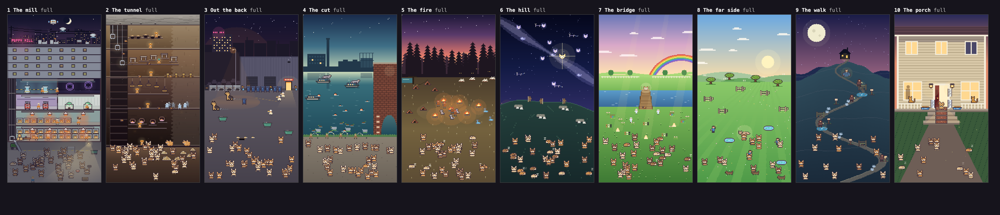
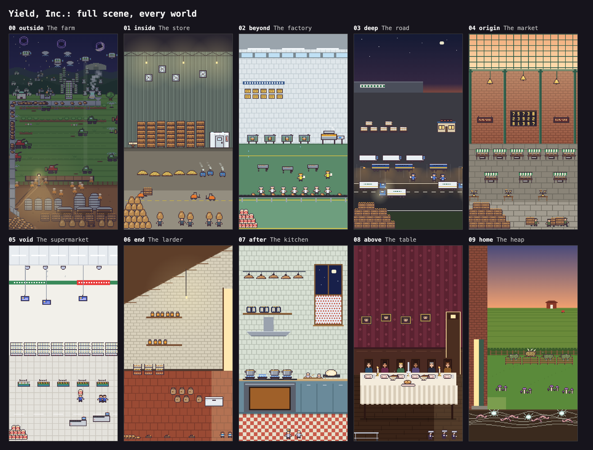

# Puppy Mill: where it stood, and where it went

> **Status.** This review was written before the rework and describes the game as it was. The
> proposal in section 6 has since been built (commit `ef64975`); the second picture below is the
> result. Not done from the list: the mill's top five rungs are still the cosmic ladder, the walk is
> still a view up the hill rather than along it, and the scenes still can't see the weather.

A consultant's review of the puppy game's ten worlds: what each one shows, says and means, what
works, what doesn't, and a proposal. Based on reading every player-facing word, the render code for
every scene, the potato rework (`b179399..9d79963`), and 183 seeded screenshots of both games
(three stages per world, the arrival cuts, the shop). Opinions are mine; where
something is inferred rather than observed it says so.

## Executive summary

**The CEO is right, and it is fixable for less than the potato job cost.**

1. **World 1 works because it is a machine you can read.** Cages make puppies, hands carry them to
   the lift, the lift drops them down the chute, they join the crowd in the lot, vans take them
   away. Every purchase adds a visible part to one picture, and the crowd of chihuahuas at the
   bottom is your money. It is also the only world with a point of view: a deadpan joke about a
   business that should not exist.

2. **Worlds 2 to 6 are the potato game's old cosmology with dogs painted on.** Inside the thing,
   the hollow world, the cave under it, the first morning, before creation: that sequence was
   written for a potato, and the potato team has just thrown it away. Puppy Mill still wears it.
   That is why a mill owner ends up strip-mining a blanket ("Fleece Face", "Seam Main"), then
   farming a dream, then a sea floor of lost tennis balls, then a Stone Age campfire, then the sky.
   No world follows from the one before, and the directions contradict each other (down, in, down,
   "wake up" into prehistory, up).

3. **The dogs disappear.** The crowd of chihuahuas, the best thing the game owns, is on screen in
   worlds 1 and 2 only. The dream has no dogs on its lawn. The sky has none. The fire has four grey
   wolves. A puppy game spends eight of ten worlds with almost no puppies in the picture, and the
   number in the HUD still says "in the yard" on the Rainbow Bridge.

4. **Worlds 3 to 10 are sticker sheets, not places.** Each rung is a row of three or four identical
   icons spaced evenly across an empty ground. Nothing does anything to anything. Thirty of a thing
   draws four sprites. Every scene is a different *kind* of picture (cutaway, floating island, sea
   floor, landscape, star map, postcard, trail map, house front) at a different scale, so the ten
   do not read as one game.

5. **The best writing in the game is in the three worlds nobody reaches.** The park, the walk and
   the porch are funny, specific and moving ("Refuses to be carried. Is being carried."; the big
   boon on the porch is "Keys in the Door"). They are priced past one lifetime. The worlds a
   first-week player actually sees, the nest and the dream, are the two least intelligible.

6. **There is a real story hiding in here, and it is better than the potato's.** You spend the game
   whistling for dogs. In world 9, "somebody is whistling, a long way off, and it is for you." In
   world 10 the top rung is "Good Dog: You." The game starts as a joke about a puppy mill and ends
   as a dog getting home. Nothing between those two points earns it.

**What I would do.** Not the potato move. The potato is a commodity and its game follows a supply
chain; nobody cares what happens to the potato. A puppy looks back at you. So:

> **The mill makes them. The rest of the game is them getting out, and getting home.**

World 2 becomes **the tunnel**: the chihuahuas are digging out under the yard. That keeps the best
non-yard scene in the repo (the cross-section with crews, lamps and hoists is already an escape
tunnel; it only thinks it is a mine), makes sense in four words, is funny, and it is where the
camera changes sides: the workers in the picture are now dogs. The arrival cut already falls into a
dog's eye. From there each world is a leg of the way home at dog height, with the pack in every
frame: the back of the estate, the canal out of town, a fire at the edge of the woods, a night on
the hill under the Dog Star, the bridge, the far side, the walk, the porch. Five of those nine
already exist and mostly need the pack put into them. Two are re-readings of scenes you have. Two
are new.

**Good looks like this:** the ten thumbnails read as one journey with ten different hours of light;
a stranger shown any scene with the HUD hidden can say where the dogs are and what they are doing
there; every gate is one plain sentence; there are never fewer than a dozen dogs on screen; and the
porch lands.

**Three decisions that are the CEO's, not mine:** whether the player changes sides at the first
gate (I say yes); whether the back four worlds are the afterlife (I say leave it readable both
ways, and stop saying "Old Age"); and whether to spend the first effort on world 2 alone as a proof
before touching the rest (I say yes).

---

## 1. How I looked

- **Words.** Every string in `apps/puppies/src/theme.ts`, `worlds.ts`, the app shell and the
  engine's feed and error lines, organised per world.
- **Pictures.** Standing in each world with
  1 of its first rung, with a dozen of its first three, and with 30 of everything. Plus
  `-scene-raw.png` (the whole canvas at 11x), the cuts, the shop and the door strip. Same for
  potatoes. The capture script became `tools/sheet.mjs`.
- **Code.** What each `render/*Scene.ts` draws and what state it can see.
- **Precedent.** What the potato rework changed, file by file.

Nothing in the games was changed for the review itself.

## 2. The game as a whole

### What the player is told

Title: "Puppy **Mill**. Breed chihuahuas. The weather will have opinions about that." You own a
mill. You whistle; puppies appear. You buy pens, hands, heat lamps, vans. Weather breaks things
while you are away. Eventually you hand the mill down for Pedigree Papers and start again.

That is a clear premise with a clear voice. Then the first gate says "The ground was never ground.
You have always been under the blanket," the card says "The Convergence," and the premise is never
mentioned again.

### The spine, as it stands

| # | Engine id | Door | The idea | Light | Direction of travel |
|---|---|---|---|---|---|
| 1 | outside | The yard | An urban puppy mill | city night, pink neon | |
| 2 | inside | The nest | The mill was on top of a blanket; mine it | tan to oxblood | down |
| 3 | beyond | The dream | Inside the dream of the dog in the blanket | indigo | in |
| 4 | deep | The deep | Under the dream, a sea floor of lost toys | teal | down |
| 5 | origin | The fire | The first campfire, the first wolf | dawn orange | "wake up", and back in time |
| 6 | void | The sky | Before dogs; the Dog Star | indigo | up, and further back |
| 7 | end | The bridge | The Rainbow Bridge, where dogs go when they die | pink over green | forward to the end of time |
| 8 | after | The far side | A park past the bridge | blue and green day | across |
| 9 | above | The walk | A hill path at night, someone whistling | navy | up |
| 10 | home | The porch | A house with the light on. You are the dog | dusk gold | in |

Read the last column top to bottom. That is the problem in one line. Worlds 7 to 10 are a sequence
(bridge, far side, uphill, home). Worlds 2 to 6 are five separate ideas about dogs, in the order
the potato's metaphysics happened to put its own five ideas.

### Who are you?

In the yard: the owner. In the nest: a miner, with a "Chorus" of "the other yous." In the dream:
something being dreamed ("It has been dreaming of you the whole time"). In the deep: also being
dreamed, by a different dog ("it is dreaming you"). At the fire: "something at the edge of the
light is deciding about you," so now you are the wolf, or the human. On the porch: "Good Dog. You.
It was always going to be you."

The game changes its mind about the protagonist five times and never stages the change. The last
answer (you are the dog) is the good one. It needs to be set up once, on purpose, early.

### What are you making?

In the yard the number is puppies and everything you buy plausibly makes puppies. In the deep a
Sunk Ball makes 701 per second of... the same number, still labelled "in the yard." A Dawn Fire
makes it. A Sunbeam makes it. A Doormat makes it. The potato game answered this ("it's the same
potatoes, now in sacks, now in bags, now on a plate") and changed the HUD word per world. Puppy
Mill has no answer, so past world 1 the purchases are just names with a rate attached.

### Tone

- Yard: corporate deadpan. "Puppies in one end, more puppies out the other. Don't ask."
- Nest: body horror. "Nobody has asked what it is curled around."
- Dream, deep: whimsy with a creepy edge.
- Fire: mythic. Sky: a joke (the Dog Star "is a Chihuahua, and it is shaking").
- Bridge: a sincere pet-loss elegy. The weather is "Grey Muzzle," "Stiff Joints," "Old Age," "One
  Last Wag."
- Park, walk, porch: warm, funny, earned.

A slide from satire to tenderness would be a strength. This is not a slide; it is six registers in
ten worlds, and the hardest one (your dog has died) arrives at world 7 of a joke clicker with no
run-up.

### Things that are true in every world and shouldn't be

- HUD says **"in the yard"**; the shop footer says "N **on the land**"; upkeep has a "**Yard**
  report"; the away report says "the **mill** kept going, and so did the **weather**"; the bar says
  **"bedding"** on the sea floor and on the Rainbow Bridge.
- "Break the cheapest thing" weather hits Puppy Pens from anywhere: **"The Vacuum Cleaner. 3x Puppy
  Pen trampled."**
- Engine words leak through the theme: "Not enough **Heirloom**" (the UI calls them papers), "put
  the **condition** right" (the UI says bedding), "handed the **site** down," and a feed line that
  prints an engine id in backticks.
- Tier blurbs pluralise by adding an s: "**Choruss** produce twice as much," "Paw Printss," "The
  Last Dogs," and you can own "**Good Dog** x25" when Good Dog is "You."
- The door strip is a row of pills laid over the top of the picture. At ten worlds it scrolls, and
  it covers the sky of every scene. The potato game replaced its copy with arrows, a list and ten
  pips; the puppy shell did not get that.

## 3. World by world

Format: what you see, what you read, what works, what doesn't.

### 1. The yard (outside) — keep; tidy

**See.** A cutaway of a multi-storey shed under a city night, pink neon PUPPY MILL sign, pigeons on
the wires. Floors of caged chihuahuas under orange heat lamps; hands in orange coats; a lift shaft;
a chute to a concrete lot where a crowd of dogs trots, sits, sleeps and plays fetch. Empty floors
wait with a bulb and a ladder. Later: a grooming salon, a lab, a reactor room, a purple singularity
room, grey office floors on top, zeppelins.

**Read.** Dry and good. "Pays for themselves. Eventually." "Do not stand in front of it."

**Works.**
- One causal loop you can follow with your finger, and you watch it run.
- The first rung *builds the place*: pens are drawn one for one up to 120 and make the building
  taller. That is why it feels like growth and not like a list.
- The crowd is the money. Spend and dogs trot off; earn and they come down the chute.
- Empty floors are a promise. One owned of anything already looks like somewhere.
- People and dogs are at one scale.
- It has an opinion.

**The "-ish".**
- Rungs 8 to 12 are where it stops being a mill. Kennel Tower is never drawn as anything but blank
  grey office floors that eat a fifth of the frame ("full" sheet, top left). Zeppelin, Fusion
  Whelper, Orbital Kennel and Singularity are the potato's escalation ladder with the nouns swapped;
  they are small, they don't join the loop, and the two back rooms are the least readable part of
  the picture.
- Its defences and weather are a farm's: Windbreak ("a wall of poplars"), Drainage Ditches, Late
  Frost, Hailstorm, Perfect Season. This is a building in a city.
- The omen before the first gate says "The horizon isn't where you left it." The scene's own header
  comment says nothing here has a horizon.
- One owned draws two (hands and lamps); small, but it is the first thing a new player buys.
- Fresh-eyes note: head-on, at this size, the chihuahuas can read as foxes or cats (pointed ears set
  high, orange and cream). The HUD face especially. Worth one pass on the head: ears lower and
  wider, bigger eyes, a domed skull.

### 2. The nest (inside) — the picture is good, the idea is not; re-read it, don't redraw it

**See.** A vertical cross-section: a pale woven lid, then four bands going down from cream to
oxblood to black. A dark shaft on the left with hoist cages on cables. Rows of little machines on
ledges: grey presses, cream blocks, purple things hanging on threads, glowing rings. Small figures
with head-lamps walking the ledges. Puppies roll off the ledges, fall down the shaft, and join the
crowd in a sump at the bottom, among tan mounds.

**Read.** Hem Hollow, Lint Hand, Fleece Face, Down Well, Seam Main, Chorus, Warm Heart, Second
Chihuahua. Defences: Padded Seams, Fresh Ticking, Lullaby Rig. Weather: "It Turns Over." Card: "The
Convergence."

**Works.**
- After the yard this is the most alive scene in the game: a crew that rides hoists, a work beat, a
  fall, a crowd. It has a loop.
- The crowd is here.
- "It Turns Over" as the name of the worst weather is a good, creepy joke.

**Doesn't.**
- Nobody can say what it is. It is drawn as a mine and named as a blanket. "Fleece Face" and "Seam
  Main" are the potato's Starch Quarry and Ring Main with fabric words on; the puns only work if you
  know they are mining terms *and* sewing terms *and* why a mill is on a blanket.
- "You have always been under the blanket" is the game's hinge, and it is the potato's hinge ("the
  ground was the inside of a potato"). A potato has an inside. A puppy mill does not.
- "The Convergence" is an engine word on a title card.
- The machines on the ledges are unreadable as objects.
- It is the world every player who gets anywhere reaches, and it is the one that makes them ask
  what game this is.

### 3. The dream (beyond) — replace

**See.** A small trapezoid of dark lawn floating in indigo space. A big cream moon with ears and a
face. A row of four blue bushes; a row of four tiny kennels; a row of four lamp posts; four blue
puddles; four pink-shirted people. A tower silhouette behind.

**Read.** Echo Kennel, Thrower ("they aren't real"), Stick Grove, Moon Puddle, Porch Light, Moon
Dog.

**Works.** The moon growing ears when you own a Moon Dog is the kind of reveal the game should do
more of. "A Running Dream" and "Belly Rub" are lovely names for good weather.

**Doesn't.**
- This is the clearest sticker sheet: five rows of four, evenly spaced, on a rug.
- No dog on the lawn. A dog's dream, without the dog.
- At "early" it is a rug in space with one kennel.
- The upper half of the frame is empty at every stage.
- Nothing connects it to a mill, or to the mine you just left.
- It shares its palette with the sky and the walk; three of ten thumbnails are the same indigo.

### 4. The deep (deep) — replace the premise, keep the water

**See.** Teal water with light shafts. A sea floor in rows: four tan sleeping dogs, four orange
corals, four tiny kennels, four divers on long hoses, four orange balls. A few angler fish. Once
you own a Fourth Chihuahua, the ridge behind turns out to be an enormous sleeping dog.

**Read.** Sunk Ball ("every ball that went over the fence ended up down here"), Diver, Slipper
Reef, Sunken Kennel, Angler Pup, Fourth Chihuahua.

**Works.** The premise sentence is a real idea and a funny one: where lost balls go. The ridge that
is a dog is the best single image past the yard. The Angler Pup sprite. Hoses trailing up out of
frame.

**Doesn't.** Rows again. The top two thirds are empty water. Why is a puppy mill under the sea?
"The dream has a floor, and the floor has a drain" is three metaphors deep. The giant is so dark
against the water that I missed it at phone size until I read the code.

### 5. The fire (origin) — keep the painting, change whose story it is

**See.** A dawn sky behind black pines; a brown clearing. In rows: four cave mouths, four bone
piles, three springs, a few campfires, four people in furs, four grey wolf-dogs sitting along the
front.

**Read.** Dawn Fire, Fire Keeper, Bone Pile ("They come for those instead of you"), Cold Spring,
Painted Cave, The First Dog ("A wolf that came to the fire and didn't leave. You know how this
goes."). Weather: "The Herds Move On."

**Works.** The backdrop is the best painted of the later worlds. The First Dog blurb is the best
line in the middle of the game. Eyes in the treeline that multiply with Bone Piles: a rung that
*does* something.

**Doesn't.** At "early" it is one campfire in an empty brown field. The gate that brings you here
is called "Wake Up" and lands you in the Stone Age. A person is the same height as a fire and
shorter than a bone pile. It has nothing to do with the mill, the blanket, the dream or the sea.

### 6. The sky (void) — keep the joke, give it a ground

**See.** Indigo sky, a fixed star field, a cross-shaped glint with a cat-like face (the Dog Star),
three pink-purple blobs, a few floating dog faces, stick-figure constellations, three plaid bands
across the top, four hooded figures on a black hill that fills the bottom quarter.

**Read.** Star Pup, Sky Herder, Crate Blanket ("thrown over the whole sky like a blanket over a
crate"), Litter Nebula, Constellation ("It's a dog. It's always a dog."), Fifth Chihuahua: the Dog
Star, which is a Chihuahua and is shaking. Weather: "No Barking."

**Works.** The Dog Star joke is the funniest thing in the game and it shakes on screen until you
upgrade it. Constellations that grow a star per generation.

**Doesn't.** A star map has no floor, so there is nowhere for anything to be; the bottom quarter is
black. The dog faces read as cats. The header comment promises "the litter sleeps on a blanket on
the hilltop"; nothing like that is drawn, and it is exactly what the scene needs. "Before there
were dogs" comes straight after "the first dog."

### 7. The bridge (end) — keep; decide what it means

**See.** A rainbow over a green meadow under a pink evening sky, a chihuahua's face on top of the
arch, three white-robed figures, three sunbeams, flowers. Puppies hop up and over the arch.

**Read.** Long Meadow, Bridge Keeper ("has a treat for every single one"; hurt: "tearful"; mend:
"Comfort"), Sunbeam, Collar Rack ("one collar for every dog that crossed"), Waiting Pack, The Last
Dog ("waiting for you, specifically, the whole time").

**Works.** Instantly readable; it is the one image in the middle every dog owner already knows. The
crossers are a loop: keepers send dogs over the bridge. It starts the run of four worlds that
follow one another.

**Doesn't.** What it is instantly readable *as* is "your dog died." The words lean on it hard, and
nothing in six worlds has prepared that register. The meadow is two thirds of the frame and empty.
The generation dogs are 2x4 brown rectangles. If one Last Dog in a hundred is broken, the single
drawn one goes dark.

### 8. The far side (after) — keep

**See.** A sunny park, mown stripes running to the sun, trees, gates standing open, paddling pools,
people throwing a ball in a slow arc, one chihuahua lying flat in a pool of light.

**Read.** "It goes on for ever and every gate is open." Sixth Chihuahua: "Has stopped shaking for
the first time in all recorded history." Weather: "Squirrel," "Fox Poo," "Sausages, Unattended."

**Works.** The writing. The stopped-shaking payoff to the Dog Star. It is a place.

**Doesn't.** A dog park with one dog in it. Things in rows on a lawn. Only the last three worlds
share code, and they left the crowd behind.

### 9. The walk (above) — keep; fix the scale

**See.** A path zig-zagging up a dark hill to a tiny house with one lit window, a big moon, hooded
walkers with torches, stiles, posts, puddles, paw prints, and a chihuahua in a coat three times the
size of the house.

**Read.** Good Post ("everybody who ever came this way has left a note on it"), Night Walker, Stile
("you have to stop and get lifted over"), Seventh Chihuahua ("Refuses to be carried. Is being
carried."). The cut: "Somebody is whistling, a long way off, and it is for you."

**Works.** The best writing in the game. The house at the top with the light on is the next world,
visible from this one: the only place the game foreshadows a gate in the picture. Paw prints that
lengthen with generations.

**Doesn't.** It is a map, not a view; nothing else in the game is drawn from above. The walkers
take three minutes to climb and are the only motion. Third indigo night.

### 10. The porch (home) — keep; it is the ending

**See.** The front of a clapboard house at dusk, lit windows, a red door standing open with light
pouring out, two lamps with moths, cats on the rails, bowls, doormats down the steps, a dog on the
top mat with its tail going. A silhouette passes the window now and then.

**Read.** House Cat ("Has been expecting you and is not pleased about it."). Height Chart. Good Dog.
Bad weather: "The Vacuum Cleaner," "Bath Night," "Suitcases in the Hall." Good weather: "Dropped
Toast," "Keys in the Door."

**Works.** The door opens wider the more Good Dogs you own. "Suitcases in the Hall" as the worst
thing that can happen is perfect. This is what the whole game should have been walking towards.

**Doesn't.** The house is drawn at about three times the scale of everything else in the game (the
door is as tall as a yard floor is wide). Four doormats in a column down the steps is the sticker
sheet again. One dog.

## 4. Why world 1 works and the others don't

Seven properties. The yard has all seven. Count them for the others.

| | Yard | Nest | Dream | Deep | Fire | Sky | Bridge | Park | Walk | Porch |
|---|---|---|---|---|---|---|---|---|---|---|
| A place you could stand in | yes | sort of | no | no | yes | no | yes | yes | no | yes |
| Follows from the world before | n/a | no | no | no | no | no | no | yes | yes | yes |
| A loop: things move stock somewhere | yes | yes | no | no | no | no | yes | part | no | no |
| The crowd of dogs is on screen | yes | yes | no | no | no | no | no | no | no | no |
| First rung builds the place | yes | part | no | no | no | no | no | no | no | no |
| Looks like somewhere at 1 owned | yes | yes | no | part | no | part | yes | yes | yes | yes |
| One scale for people and dogs | yes | yes | yes | yes | no | n/a | part | yes | no | no |

Two more things under the table.

**Counts.** Worlds 3 to 10 draw on a log10 curve: 6 owned shows 3, 17 shows 4, 46 shows 5. So at
any stage a real player sees, each rung is three to five sprites, which is why everything is a row
of four. The potato scenes use a curve that is one for one up to four and then log2, and the yard
draws pens one for one.

**What the scenes can't see.** No scene is told about weather events, defence buildings, a pending
gate, or depth. So the thing the game is *about* (weather taking production away, and what you
built to stop it) is never in the picture in any world, including the yard. Condition is the only
signal and it mostly arrives as a tint.

## 5. What the potato team did, and what to take from it

**What they did.** Deleted six cosmic scenes (about 5,650 lines), wrote nine short ones on a shared
base class (about 2,100 lines in all), renamed every rung, upgrade, building and weather event past
the farm, left the engine untouched, and treated engine ids as slots. One large commit and two
follow-ups; 29 files; +3.7k / -8.7k lines. The rules they wrote down:

- One literal chain: farm, store, factory, road, market, supermarket, larder, kitchen, table, heap.
  Each gate is "you own this link; somebody else does the next."
- One grammar: side-on, a floor you can see, your stock piled front left in that world's packaging,
  people carrying things to it. "No glow-badge producers."
- Drawn at the size things are.
- The HUD speaks the world: where the stock is, what the button does, what the bar measures.
- Cuts open with a plain line, then the joke, then the card.
- Each gate is foreshadowed in the picture before it (the store appears on the far hill).
- Rung roles show in the art (the generation rung gains a page, a plaque, a spine per generation).

**Take:** slots not ids; a shared base so each scene is only its picture; the stock visible in every
world; plain-line-first cuts; the per-world HUD words; the foreshadowed gate; the thumb-sized world
switcher (that one is a straight port).

**Leave:**
- **The supply chain.** It is the right answer for a commodity. Run it for dogs (mill, van, pet
  shop, living room) and you get the potato game again with two of its places duplicated, the player
  stays the villain to the end, and the ending you already have is wasted.
- **The pile.** Their stock is inert, so it is a heap. Yours is alive. The design doc already says
  it: "the hoard is a crowd, not a pile." You have a pack simulation with nine poses and a fetch
  game. That is your pile, and it is better than theirs.
- **Total literalism.** Their scenes are clear and, honestly, a little flat: clean rooms, flat
  colour, not much air. The mill at night has more atmosphere than any of them. Take the legibility,
  keep the mood.

## 6. The proposal

### The sentence

> **The mill makes them. The rest of the game is them getting out, and getting home.**

One night, a tunnel, and the long way to a porch with the light on. The count is the pack. The
purchases are what the pack finds and who it meets on the way. The weather is whatever is after
them.

### Why this and not something else

- It is the story the game is already trying to tell at both ends, so it keeps the good half.
- It gives the title a second meaning instead of an apology.
- It makes the tone a slope: grim joke, caper, nervous, open air, tender. Each world is one step
  warmer than the last.
- It lets the player change sides once, on purpose, at the first gate, and stay changed.
- Every world answers "why am I here?" with "because it's the next bit of the way."

### The ten worlds

| # | Slot | Now | Proposed | Light | Reuse |
|---|---|---|---|---|---|
| 1 | outside | The yard | **The mill** | midnight, neon | as is, tidied |
| 2 | inside | The nest | **The tunnel**: they are digging out under the yard | lamp-lit earth | the nest scene, re-read |
| 3 | beyond | The dream | **Out the back**: the estate behind the mill at 3am; bins, a chip shop's back door, the mill's own vans out looking | sodium orange on black | new |
| 4 | deep | The deep | **The cut**: the canal out of town before dawn, seen in section; towpath above, lost balls and a trolley below | teal | the water, the balls, the diver; new top half |
| 5 | origin | The fire | **The fire**: somebody camped at the edge of the woods, throwing scraps past the light | dawn | the scene and half the words |
| 6 | void | The sky | **The hill**: the pack asleep in the open under the Dog Star | indigo | the sky; add the ground |
| 7 | end | The bridge | **The bridge**: morning after rain, a rainbow over it | pink and green | as is, with the pack |
| 8 | after | The far side | **The far side** | afternoon | as is, with the pack |
| 9 | above | The walk | **The walk** | dusk into night | words as is; redraw from the path, not above it |
| 10 | home | The porch | **The porch** | porch light | as is, at the game's scale |

Notes on the ones that change.

**2. The tunnel.** Chihuahuas burrow; that was the seed of the nest idea and it is the part worth
keeping. The cross-section, the shaft, the ledges, the crew with lamps, the hoist cages, the spoil
heaps in the sump, the pups tumbling down to join the crowd: all of it is an escape tunnel already.
Change the crew from people to dogs and the camera has changed sides without a word of
explanation. The eight rungs map across almost one for one: a scrape, a digger, shoring made of bed
slats, an air line (the condition rung: only as good as the bedding up top, which is the existing
blurb), a trolley on a rail, the Chorus becomes the howl upstairs that covers the noise (the
generation rung: every generation that dug before), a den, and the dog with the plan. Weather:
cave-ins, a hand looking down the hole, rain. "It Turns Over" goes; "The Nest Settles" becomes a
roof fall. The card stops saying "The Convergence."

The first gate becomes: *"One of them is looking at the fence."* Then the fall into the eye, which
is already built. Then: *"They have been digging the whole time."* Card: **Out.**

**3. Out the back.** The first air. Still the mill's world: its vans are this world's weather. The
first kind human in the game is somebody at a back door with a tray of scraps. This is where "dogs
you own" turns into "dogs you are with."

**4. The cut.** A canal leaves every town, and "every ball that went over the fence ended up down
here" is literally true of one. Keeps the teal, the light shafts, the balls, the diver (a
magnet-fisher), the slipper. Loses the sea, the dream's floor and the drain.

**5. The fire.** Same painting. The line "something at the edge of the light is deciding about you"
stays word for word and now means the pack, deciding about the person. "A wolf that came to the
fire and didn't leave. You know how this goes." stays too; it is now a rhyme with what the pack is
doing rather than a trip to the Stone Age. Wolves in the treeline become foxes, or stay eyes.

**6. The hill.** Give the sky a ground and put the litter asleep on it, as the scene's own header
always said. The Dog Star is what they are walking towards. It is a Chihuahua. It is still shaking.

**The dream** stops being a place. Its good parts move: the moon with ears goes to the hill; "A
Running Dream" and "Belly Rub" stay as good-weather names wherever the pack sleeps.

### The whistle

You whistle; dogs come. That is the first thing the game teaches and the button never goes away.
Use it. Take the potato's per-world verb (Dig in the tunnel, and so on), but keep **Whistle** for
world 1 and bring it back in world 9, where the cut says somebody is whistling for you. On the
porch the button says **Come**. That is the whole twist, on the one control the player has touched
ten thousand times. It costs one field in `worlds.ts`.

### The bridge, and what it means

The back four worlds read as the afterlife: a mill dog that never had a home goes to the one it
never had. That is the strongest version of this story and I would not remove it. I would stop
*saying* it. "Old Age," "Stiff Joints," "Grey Muzzle," "every dog that ever ran ends up running
here" close the question. A bridge with a rainbow over it after rain, a park where no gate is ever
shut, a hill, a light: people who know will know, and it will hit harder for not being announced.
People who don't get a happy ending. Either way it is the CEO's call, because it sets how sad the
game is allowed to be.

### The picture grammar (the yard's, written down)

1. **Three bands, every world.** Top: where you are (sky, backdrop, the next world in the
   distance). Middle: the works, the things you bought, doing something. Bottom quarter: the pack
   strip. The yard is already this.
2. **The pack is in every frame.** Same simulation as the lot. Spend and dogs leave; earn and they
   arrive. Never fewer than a dozen once a world is going.
3. **Each world has an arrival.** The yard has the chute. The tunnel has the fall down the shaft.
   The bridge has the crossers. Every other world needs its own way for a new dog to visibly join:
   out of a bin, up the canal bank, out of the trees, over the stile, through the door.
4. **The first rung builds the place.** Pens build the mill. The first rung of each world should be
   the thing there is most of, drawn one for one for a long way, and it should change the shape of
   the picture.
5. **Cluster, don't rank.** No rows of four. Use the one-for-one-to-four curve. Put things where
   they would be, not where the column is.
6. **Dog height, one scale.** A person is about twelve pixels, a dog about eleven, in every world.
   No maps, no fronts of houses at three times life size.
7. **A place from the first second.** The backdrop does the work, so one owned of the first rung is
   a dog arriving somewhere, not a campfire in a field.
8. **One big dog per world.** The moon that grows ears. The ridge that is a sleeping dog. The star
   that is a Chihuahua. This is the game's own signature and nobody chose it on purpose. Choose it:
   in every world, the top rung turns part of the landscape into a dog. Then stop numbering them;
   "Second" through "Seventh" Chihuahua, with a First Dog and a Last Dog in between and the Third as
   an upgrade, is a count nobody can follow.
9. **Ten hours of light.** Each world owns one hour and one dominant colour, so the door strip reads
   as a night and a day. Today three worlds are the same indigo.
10. **Show the next world before the gate.** The walk already does (the lit window). The mill
    should: as the first gate nears, a dog in the lot stops playing and sits facing the fence.
11. **Let the scene see the weather.** Out of scope for a first pass, but the game's thesis is never
    drawn. Passing the last event and the defence levels into the view would let a van prowl the
    estate or a roof fall happen where you can watch it.

### The words

- One sentence per gate, plain, in the shape "this, so that." If it needs a second metaphor it is
  wrong.
- Cuts: plain line, then the turn, then the card. The puppy cuts currently open on the riddle.
- Per world: where the pack is ("in the yard" / "underground" / "out"), the button, the bar. "Bedding"
  is right for the mill and the tunnel and wrong everywhere else.
- Keep the voice of worlds 8 to 10. It is observational and specific to dogs: being lifted over a
  stile, reading a post, a cat that is not pleased. The middle worlds are written about ideas; the
  back three are written about dogs.

## 7. What good looks and feels like

Tests you can run on a screenshot, not a vibe.

- **The contact sheet.** Ten thumbnails in a row read as one game and one journey, and no two are
  the same colour.
- **The stranger.** HUD hidden, any world, any stage: a stranger can say where this is, what the
  dogs are doing there, and point at what just changed when you buy something.
- **The sentence.** Each gate can be said aloud in one plain sentence to someone who has not played,
  and they nod.
- **The count.** A dozen dogs on screen, minimum, in every world.
- **The first second.** Every world looks like a place with one thing owned.
- **The whistle.** A player who reaches the walk notices who is whistling.
- **The porch.** It lands. If it gets a laugh and then a silence, the game is right.

Feel: the yard should make you laugh and wince. The tunnel should make you switch sides and grin.
Out the back should feel like getting away with something. The fire should feel like the first
time anyone was kind. The bridge should be quiet. The porch should feel like being let in.

## 8. How to get there

Engine untouched throughout; ids are slots, as in the potato game. Saves are safe as long as no id
is reused.

**Step 0. Decide** the three calls in the summary. Nothing below is worth starting without the
sentence agreed.

**Step 1. The shell, both cheap and already written next door.**
- Port the potato `WorldStrip` (arrows, list, pips) and the `held` / `verb` / `kept` fields.
- Stop engine words leaking: "Heirloom," "condition," "site," the backticked id, and give the theme
  a plural so "Choruss" goes away. This is an engine change and fixes both games.
- Fix the yard's farm words and its omen line.
- Give void and end the "lone hero" rule the last three worlds already have.

**Step 2. A puppy `LongScene`.** Lift the pack, the three bands and the arrival out of
`millScene.ts` into a base class, so a world is only its backdrop, its works and its arrival. The
puppy game has a `longScene.ts` for its last three worlds; it has no pack in it.

**Step 3. World 2, alone, as the proof.** Re-read the nest as the tunnel: words, crew sprites, the
gate, the cut lines, the dog at the fence in the mill. It is the world every player reaches, it
reuses the most, and it is where the side-change either works or doesn't. Show it to the CEO before
anything else moves.

**Step 4. Put the pack into 7 to 10.** Small: they are already on the shared base. Fix the walk's
viewpoint and the porch's scale while there.

**Step 5. The middle.** Out the back and the cut are new scenes; the fire and the hill are
re-readings. Rename rungs, upgrades, buildings and weather for 3 to 6. Redraw the cut subjects.

**Step 6. The mill's top end.** Decide whether rungs 8 to 12 stay cosmic. I would bring them back
to earth (a second site, a franchise, a kennel club) so the mill is a mill until the dogs leave it,
but this is the least urgent thing on the list.

**Size.** The potato job replaced nine worlds. This replaces two, re-reads three and upgrades four.
The bulk is `art.ts` (sprites and their marks) and `theme.ts`, as it was for them.

## 9. Tools worth keeping from this review

- **A contact sheet command.** The script that made the two sheets at the top of this file should
  live in `tools/` next to `shot.mts`: every world, three stages, both games, one image. It is the
  fastest way to see whether a change makes the ten read as one game, and nothing else in the repo
  shows more than one world at a time.
- `shot.mts open=worlds` only works in potatoes until the switcher is ported.

## Appendix: small things found on the way

- Two rungs are called Porch Light (dream and porch). "Good Dog" is both an upgrade at the fire and
  the porch's top rung. "Soft Grass" is a defence in two worlds. "Night Shift" is a perk and a tier
  upgrade. "It Was Always You" is a tier name twice.
- The gate name and the arrival card disagree in five worlds (Deeper Sleep / The Deep; Wake Up / The
  First Fire; and so on).
- Void and end share a shop sentence; so do the last three worlds.
- "Pedigree do two jobs."
- The dream cut zooms into fur beside the shut eye; it reuses the nest cut's focus pixel.
- The sky's star field is seeded with a constant, so it is the same for every save.
- `EYE` in `art.ts` is unused. Several mark comments in `art.ts` and names in `insideScene.ts` are
  find-and-replace leftovers from the potato game ("Pit Hand," "Tracked Chassis," "pup" for "pulp").
- The nest has ten heap slots and can only ever fill nine.
